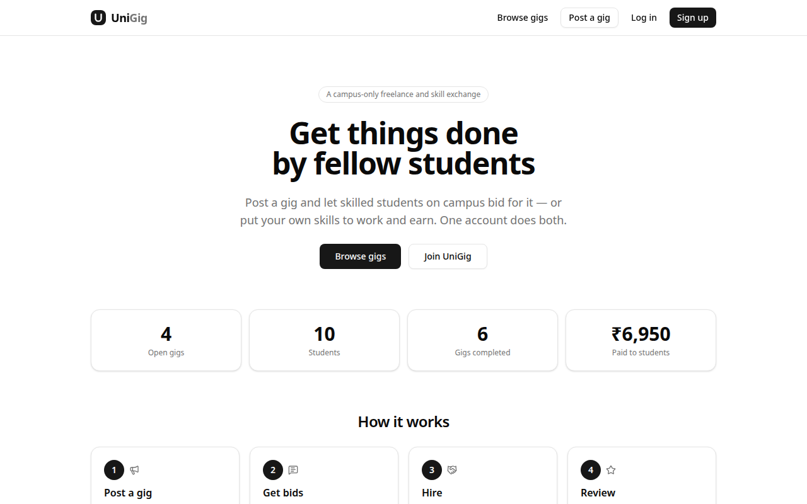
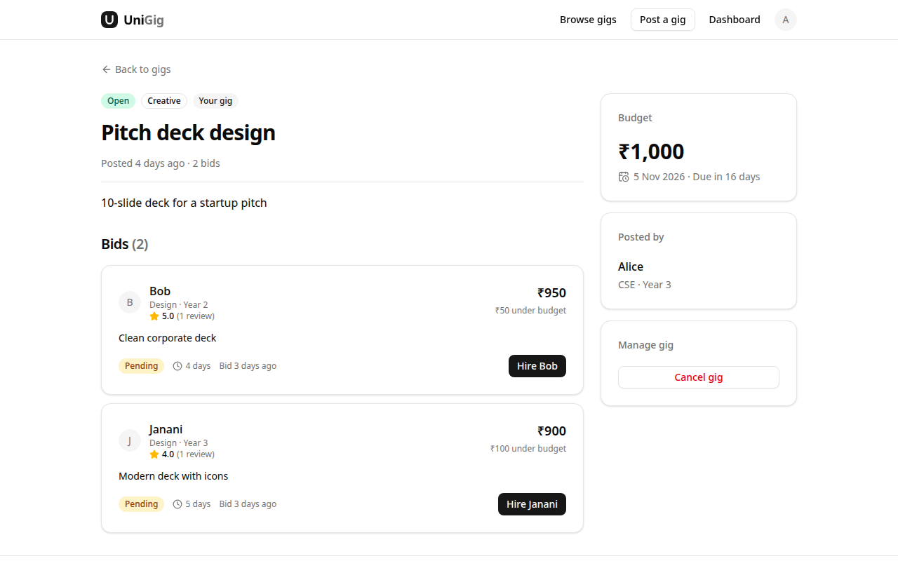
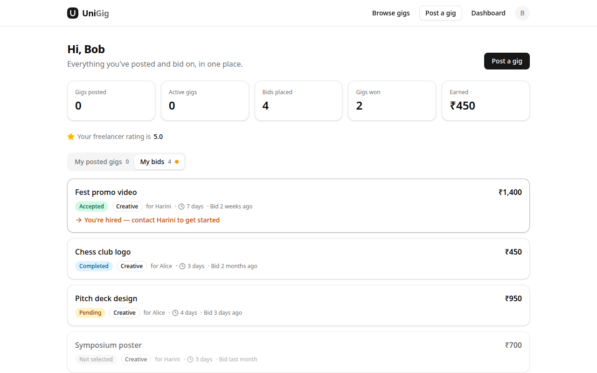

# UniGig

**A campus-only freelance marketplace.** Students post small paid jobs (*gigs*), other students bid on them, the poster hires one, and a review builds the freelancer's rating. Think a mini Fiverr or Upwork for one university.



This is a working prototype built as a college project. It grew out of a DBMS assignment that designed the UniGig database in Oracle SQL. This repo turns that design into a full-stack web app.

## Features

- **One account, both roles.** Every student can post gigs *and* bid on other people's gigs; the only rule is that you can't bid on your own.
- **Browse and search** open gigs by keyword and category, sorted by newest, budget or deadline.
- **Bidding.** Send a price, a timeline and a message. Bids are private between the bidder and the gig owner.
- **Hiring.** The owner picks one bid; every other bid is declined automatically and the gig moves to *In progress*.
- **Contact reveal.** After a hire, the client and the hired freelancer see each other's phone number and email. Nobody else ever does.
- **Reviews and ratings.** Once the gig is marked completed, the client leaves a 1–5 star review, and the freelancer's rating is recalculated.
- **Dashboard** of everything you've posted and bid on, with "what to do next" hints.
- **Profiles** with skills, ratings and reviews received.

| Gig owner choosing a bid | Freelancer dashboard |
|---|---|
|  |  |

## How a gig works

```text
 Client posts gig ──▶ OPEN ──── students bid ────▶ client hires one bid ──▶ IN_PROGRESS
                       │                            (others auto-declined)        │
                       └──▶ client cancels ──▶ CANCELLED          contact details shared
                                                                                  │
                    rating recalculated ◀── client reviews ◀── COMPLETED ◀── client marks done
```

## Tech stack

| Layer | Choice |
|---|---|
| Framework | [Next.js 15](https://nextjs.org) (App Router, Server Components, Server Actions), TypeScript |
| UI | [Tailwind CSS 4](https://tailwindcss.com), [shadcn/ui](https://ui.shadcn.com) components, [Lucide](https://lucide.dev) icons |
| Database | SQLite via [better-sqlite3](https://github.com/WiseLibs/better-sqlite3) |
| ORM / migrations | [Drizzle ORM](https://orm.drizzle.team) and drizzle-kit |
| Validation | [Zod](https://zod.dev) |
| Auth | Email and password (bcrypt hashes), session tokens stored hashed in the database, httpOnly cookie |

There is no separate backend: pages read from the database in Server Components, and forms submit to Server Actions. Forms also work with JavaScript turned off.

## Getting started

**Prerequisites:** [Node.js](https://nodejs.org) **22 or newer** (needed by the SQLite driver) and npm.

```bash
git clone https://github.com/madhusudhan-muppi/UniGig.git
cd UniGig/web

npm install          # install dependencies
npm run db:migrate   # create the SQLite database in web/data/unigig.db
npm run db:seed      # load the demo data (safe to re-run: it resets everything)
npm run dev          # start the app
```

Open <http://localhost:3000>.

To run the optimised production build instead of the dev server: `npm run build && npm start`.

### Demo accounts

Every seeded account uses the password **`password123`**.

| Email | Good for showing |
|---|---|
| `alice@uni.edu` | A **client** with an open gig ("Pitch deck design") that has 2 bids waiting |
| `harini@uni.edu` | A **client** with a gig in progress ("Fest promo video"), ready to complete and review |
| `bob@uni.edu` | A **freelancer** with a 5.0 rating, a current hire and a pending bid |
| `gokul@uni.edu` | Someone who **does both**: posts gigs and lists Web Development as a skill |
| `charan@`, `divya@`, `eshwar@`, `fathima@`, `irfan@`, `janani@uni.edu` | More students with bids, reviews and skills |

You can also sign up with any email to start from an empty account.

## Demo walkthrough (about 5 minutes)

Run `npm run db:seed` first so the data is fresh. Use a normal window and a private/incognito window to be two people at once.

1. **Landing page.** Live numbers, the latest open gigs and the top-rated students.
2. **Browse.** Open *Browse gigs*, search for "deck", filter by *Creative*, sort by budget.
3. **Post a gig** as `alice@uni.edu`. Try submitting an empty form to show the validation, then post a real one.
4. **Bid** on Alice's new gig as `irfan@uni.edu` (in the private window). Show that:
   - a price above 150% of the budget is rejected,
   - Alice can't bid on her own gig,
   - Irfan can't bid twice.
5. **Hire.** Back as Alice, open the gig and click **Hire Irfan**. The gig becomes *In progress* and both sides now see each other's phone and email. Log in as a third student to show they don't.
6. **Complete and review** as `harini@uni.edu`: open *Fest promo video*, click **Mark as completed**, give Bob 4 stars. Bob's rating drops from **5.0 to 4.5**, the same result as the rating trigger in the DA-2 SQL.
7. **Dashboard and profiles.** Show Bob's dashboard (earnings, won bids, "You're hired" hint) and Bob's public profile (skills, reviews, no contact details).

## How the database design carries over

The app's schema ([`web/src/db/schema.ts`](web/src/db/schema.ts), generated SQL in [`web/drizzle/0000_init.sql`](web/drizzle/0000_init.sql)) follows the BCNF design from the DBMS assignment, with one deliberate change: **roles overlap**. The assignment's EER model allowed a student to be both client and freelancer, so there is no `user_type` column. Any user can post and bid.

| Tables | |
|---|---|
| `users` | Every student; `rating` caches the average of reviews received |
| `skills`, `user_skills` | Skill catalogue and the many-to-many link to users |
| `gigs` | Jobs, with status `OPEN → IN_PROGRESS → COMPLETED`, or `CANCELLED` |
| `bids` | Offers on gigs; unique on `(gig_id, freelancer_id)` |
| `reviews` | One per gig (unique `gig_id`), rating 1–5 |
| `sessions` | Login sessions (stores only a hash of the cookie token) |

The PL/SQL logic from the assignment lives in server actions, each inside a database transaction:

| DA-2 Oracle object | In the app |
|---|---|
| `CHECK` / `UNIQUE` / `FOREIGN KEY` constraints | Same constraints in the SQLite schema |
| `trg_validate_bid` (open gig, freelancer only, ≤150% of budget) | `placeBid` in [`actions/bids.ts`](web/src/app/actions/bids.ts) |
| `sp_accept_bid` (accept one, reject the rest, gig in progress) | `acceptBid` in [`actions/bids.ts`](web/src/app/actions/bids.ts) |
| `trg_update_freelancer_rating` (recalculate average rating) | `submitReview` in [`actions/reviews.ts`](web/src/app/actions/reviews.ts) |
| `vw_freelancer_performance` / `fn_freelancer_earnings` | Dashboard stats and the *Top-rated students* list |
| Sample data (`01_schema_and_data.sql`) | [`web/src/db/seed.ts`](web/src/db/seed.ts), with dates made relative to today |

## Project structure

```text
web/
├── drizzle/                 Generated SQL migrations
├── src/
│   ├── app/                 Pages (App Router)
│   │   ├── actions/         Server actions: auth, gigs, bids, reviews, profile
│   │   ├── gigs/            Browse, post (/new) and gig detail ([id])
│   │   ├── dashboard/       My posted gigs / My bids
│   │   ├── users/[id]/      Public profile
│   │   ├── profile/         Edit your profile and skills
│   │   └── login/, signup/
│   ├── components/          UI components (ui/ holds the shadcn primitives)
│   ├── db/                  schema.ts, queries.ts, seed.ts, connection
│   └── lib/                 auth (sessions), formatting, shared constants
└── data/                    SQLite database file (not committed)
```

## Scripts

Run these from `web/`.

| Command | What it does |
|---|---|
| `npm run dev` | Start the development server on port 3000 |
| `npm run build` / `npm start` | Production build / serve it |
| `npm run lint` | ESLint |
| `npm run db:migrate` | Apply migrations in `drizzle/` to `data/unigig.db` |
| `npm run db:seed` | Wipe the database and load the demo data |
| `npm run db:generate` | Create a new migration after editing `src/db/schema.ts` |
| `npm run db:studio` | Browse the database in Drizzle Studio |

To start completely fresh, delete `web/data/` and run `db:migrate` and `db:seed` again.

## Not in the prototype yet

- Restricting sign-up to verified campus email addresses (sign-up is open to any email for now)
- Notifications for new bids, hires and reviews
- In-app chat and payments (contact details are shared after hiring instead)
- "Recommended for you" gigs that match your skills
- Hosting online (the prototype runs locally; a hosted version would need a hosted SQLite such as Turso)
